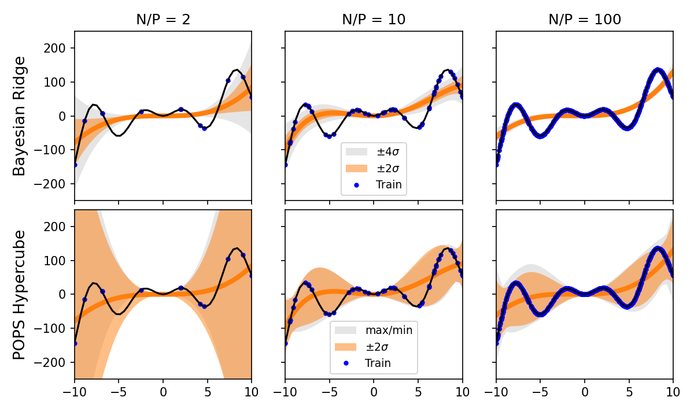

# POPS-UQ: post-Bayesian regression for misspecified, near-deterministic models

A model is *misspecified* when no choice of parameters can reproduce the underlying response. In the *near-deterministic* regime, repeated observations at a given input have little or no noise. This is common in computational surrogate modeling. A potential fitted to electronic-structure calculations, for example, can reproduce some atomic forces exactly, yet require different parameters to reproduce others.

Under misspecification, a conventional Bayesian parameter posterior can concentrate on a single best fit as the training set grows. The parameter uncertainty due to model-form error persists. Propagating the concentrated posterior through a downstream simulation can therefore substantially underestimate uncertainty in its predictions. [Swinburne and Perez, MLST (2025)](https://doi.org/10.1088/2632-2153/ad9fce)

**Pointwise Optimal Parameter Sets (POPS)** provide a theoretically grounded, computationally efficient way to quantify that uncertainty. For each observation, POPS finds the parameters that fit it exactly while minimizing the loss on the full dataset. For high-dimensional models linear in their parameters, these constrained fits reuse the same matrix factorization. The resulting parameter ensemble can be propagated through subsequent calculations.

[Explore the interactive tutorial](tutorials/index.md){ .md-button .md-button--primary }

[PAC-Ellipse regression and finite-sample risk bounds](method/pac-ellipse.md){ .md-button }

## Polynomial regression in the low-noise regime

{ .figure }

Read each row from left to right. Adding simulator runs pins down the best quartic polynomial. The top row shows how its parameter uncertainty shrinks. The bottom row shows how much its parameters would have to vary to reach individual observations. Even at the highest data density, the target still oscillates beyond what one quartic can follow.

## Method and applications

1. **Diagnose the error.** Change the simulator in the [interactive lab](tutorials/index.md) and measure what happens between training points.
2. **Construct the ensemble.** Find the smallest increase in total loss compatible with fitting each observation exactly. Follow the [linear derivation](overview.md) and the [hypercube algorithm](method/hypercube.md).
3. **Propagate a model.** Use the same parameter draw throughout a downstream calculation. The [research guide](citation.md) connects this idea to interatomic potentials and finite-data risk bounds.

## Quick start

Choose the implementation for your workflow. The [Python package](implementations/python.md) provides a regression estimator. [POPSRegression.jl](https://pops-uq.github.io/POPSRegression.jl/) is a standalone Julia package with its own installation guide, API reference, and molecular dynamics examples.
